# c4ptur3-th3-fl4g — TryHackMe Walkthrough

[](https://tryhackme.com/room/c4ptur3th3fl4g)
[]()
[]()

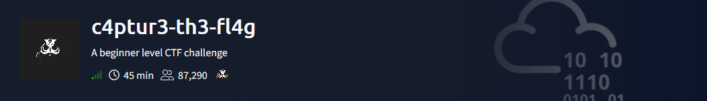

A walkthrough of the **c4ptur3-th3-fl4g** room on TryHackMe — a beginner-friendly room covering classic encoding/decoding schemes, spectrogram analysis, steganography, and "security through obscurity."

**Room:** https://tryhackme.com/room/c4ptur3th3fl4g

> **Note on answers:** in line with TryHackMe's request not to publish full task answers, the decoded strings below are partially redacted (first/last letter shown). The focus here is the *method* — the tool, recipe, or command used to reach the answer — not the literal string to submit.

---

## Task 1 — Translation & Shifting

Each question gives an encoded string; the goal is identifying the encoding and decoding it.

| # | Encoding | Tool / Method | Decoded (redacted) |
|---|----------|----------------|---------------------|
| Q1 | Leetspeak | Manual substitution | `c*n y*u c*****e t*e f**g?` |
| Q2 | Binary | [morsecodeninja.com/binary](https://www.morsecodeninja.com/binary.html) | `l**s t*y s**e b****y o*t!` |
| Q3 | Base32 | [CyberChef — From Base32](https://gchq.github.io/CyberChef/) | `b****2 is s***r c****n in C***s` |
| Q4 | Base64 | CyberChef — From Base64 | `E**h B****4 d***t r********s e*****y 6 b**s of d**a.` |
| Q5 | Hex | Manual / CyberChef — From Hex | `h*********l or b****6?` |
| Q6 | ROT13 | CyberChef — ROT13 | `R****e me 13 p****s!` |
| Q7 | ROT47 | CyberChef — ROT47 | `Y*u s**n me r***t r***d b**y r***t r***d (47 t***s)` |
| Q8 | Morse code | CyberChef — From Morse Code | `T**************O  E******G` |
| Q9 | Decimal (byte values) | CyberChef — From Decimal | `U****k t**s B*D` |
| Q10 | Multi-layer (Base64 → Morse → Binary → ROT47 → Decimal) | Chained CyberChef recipes | `L***s m**e t**s a b*t t******r...` |

Screenshots of the decode process for the trickier ones:

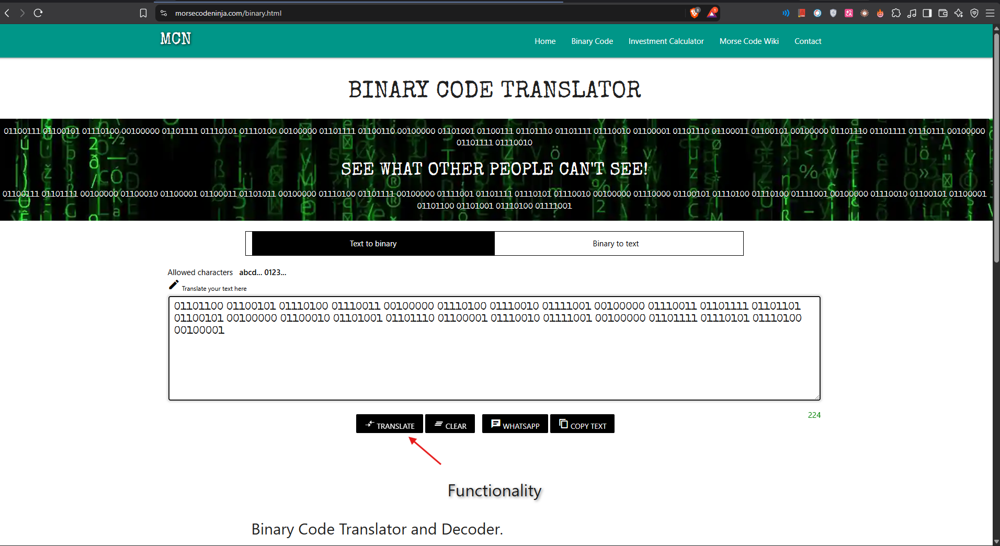
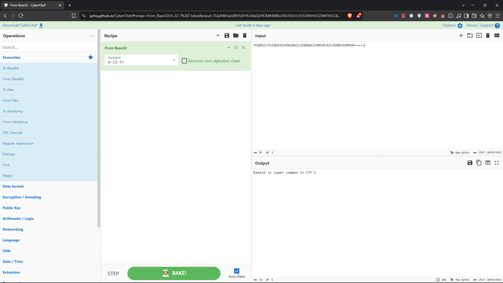
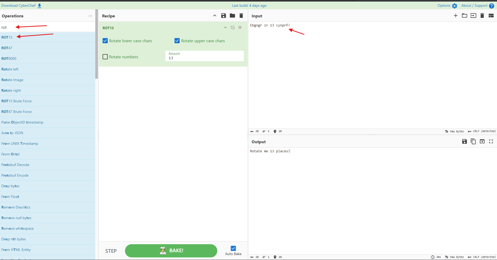
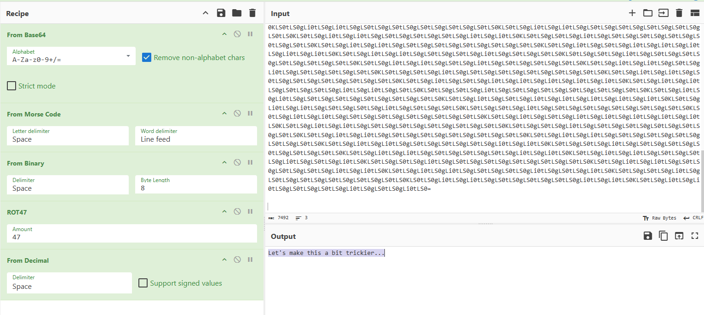

---

## Task 2 — Spectrograms

A spectrogram is a visual representation of a signal's frequency spectrum over time — used here to hide a message inside an audio file.

**Method:**
1. Upload the provided audio file to [dcode.fr/spectral-analysis](https://www.dcode.fr/spectral-analysis).
2. Set the scroll speed to full.
3. Read the message rendered across the frequency plot.

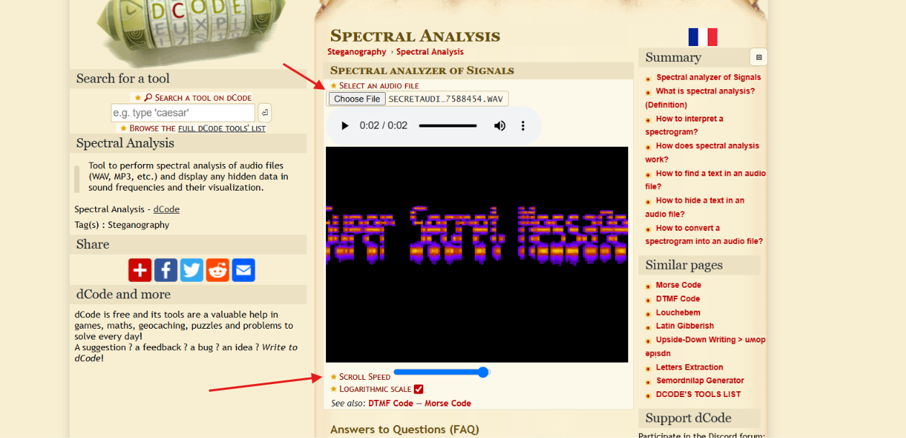

---

## Task 3 — Steganography

Steganography hides data inside another file (here, an image) without visibly altering it.

**Method — extract a passphrase-protected payload with `stegseek`:**

```bash
stegseek --seed stegosteg_1559008553457.jpg
```

`stegseek` brute-forces common wordlists against the embedded `steghide` payload and, on success, writes out the hidden file.

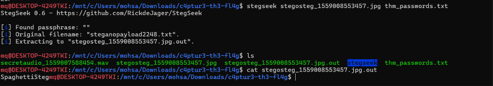

---

## Task 4 — Security Through Obscurity

"Security through obscurity" relies on hiding *how* something works rather than properly securing it — easy to defeat once you know where to look.

**Step 1 — carve embedded files out of an image with `binwalk`:**

```bash
binwalk -e meme_1559010886025.jpg
```

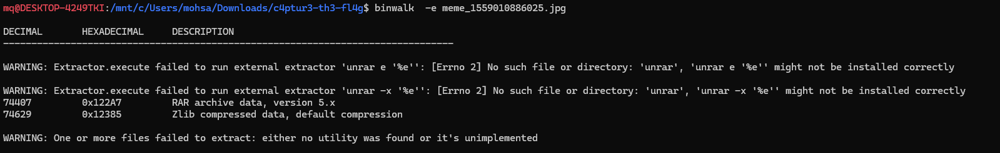

**Step 2 — unpack the extracted archive:**

```bash
cd _meme_1559010886025.jpg.extracted
ls
unrar e 122A7.rar
```

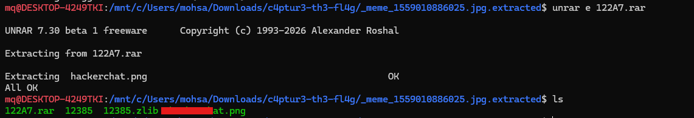

**Step 3 — pull hidden text out of a non-text file with `strings`:**

```bash
strings ha********.png
```

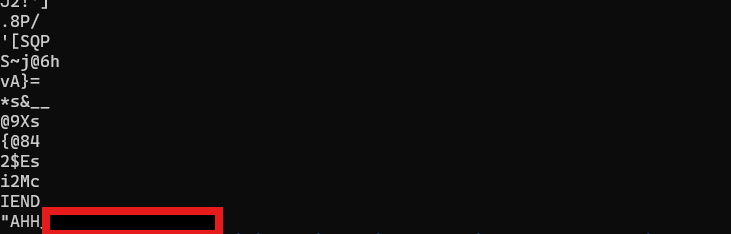

- **Q1:** First filename & extension found inside the extracted archive → `ha**********ng`
- **Q2:** Hidden text found inside that file → `AH************ME!`

---

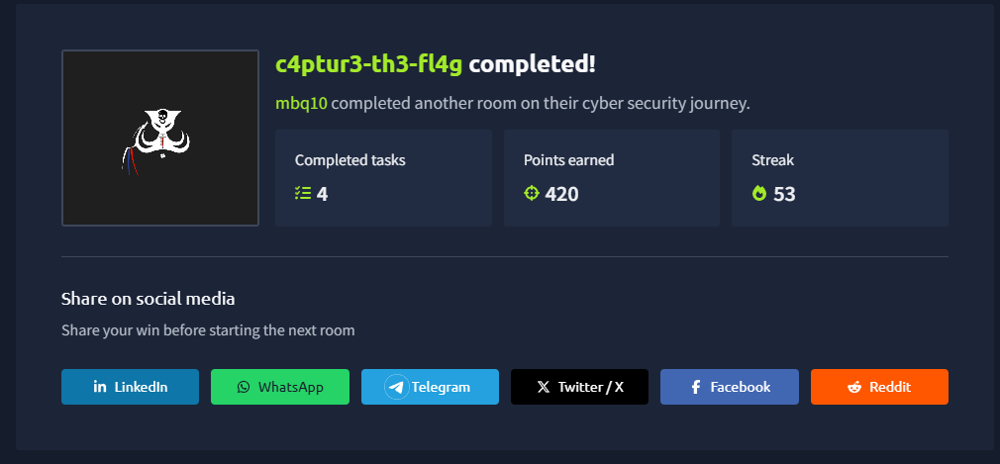

## Skills Demonstrated

| Area | Skill |
|------|-------|
| Encoding/Decoding | Base32/Base64, hex, binary, ROT13/ROT47, Morse code, decimal, chained multi-layer decoding |
| Signal analysis | Reading hidden messages from audio spectrograms |
| Steganography | Extracting `steghide`-embedded payloads with `stegseek` |
| File forensics | Carving embedded files with `binwalk`, extracting archives, pulling strings from binaries |

---

## Disclaimer

This walkthrough documents work performed on a TryHackMe lab room for educational purposes. Final task answers are intentionally redacted out of respect for TryHackMe's request not to publish literal solutions — this repo demonstrates the techniques, not a copy-paste answer key.
